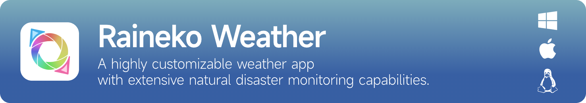

<a href="README.md">简体中文</a> &nbsp; · &nbsp; <a href="README.zh-TW.md">繁體中文</a> &nbsp; · &nbsp; <b>English</b> &nbsp; · &nbsp; <a href="README.ja.md">日本語</a>

<h2 align="center">A new chapter. A fresh look.</h2>

See the weather from a new perspective.

<a href="https://weather.raineko.net/"><b>Website</b></a> &nbsp; · &nbsp; <a href="https://weather.raineko.net/downloads.html"><b>Download</b></a> &nbsp; · &nbsp; <a href="https://weather.raineko.net/preview.html">Preview program</a> &nbsp; · &nbsp; <a href="https://weather.raineko.net/feedback.html">Feedback</a>

Windows &nbsp; / &nbsp; macOS &nbsp; / &nbsp; Linux &nbsp; · &nbsp; Alpha Preview

 

<h2>Everything at a glance.</h2>

The weather now. The updates that matter. Bring a world of information into one clear view.

Your day, in one view

<table>
  <tr>
    <td width="33%" valign="top"><h3>☁️ Weather & forecasts</h3>
The weather now. The updates that matter.
</td>
    <td width="33%" valign="top"><h3>🌏 A wider view</h3>
From the clouds above to the earth below and the seas beyond.
</td>
    <td width="33%" valign="top"><h3>🎨 Personal themes</h3>
From colors to atmosphere, make Raineko your own.
</td>
  </tr>
</table>

<h2>A wider view of the world.</h2>

Stay connected to data from across regions. From updates to alerts, stay informed as things change.

Earthquake alerts and intensity distribution · Interface screenshot

<h3>Station observations at a glance.</h3>

Station coverage and observation interface

 

<table>
  <tr>
    <td width="50%" valign="top"><h3>A theme for every mood. A look to make your own.</h3>
One click, a different mood. From colors to atmosphere, make Raineko your own.
</td>
    <td width="50%" valign="top"><h3>Look through Nature Lens. Listen to the natural world.</h3>
Watch rainfall become a landscape, and let the sound of rain fill a quiet moment. Weather is something you can feel, too.
</td>
  </tr>
  <tr>
    <td width="50%" valign="middle"></td>
    <td width="50%" valign="middle"></td>
  </tr>
</table>

The overview, themes, alert map and station map use recent screenshots provided by the user. Nature Lens uses existing website promotional material. Images illustrate the interface, not live weather or disaster conditions.

<h2>Get started</h2>

Visit the <a href="https://weather.raineko.net/downloads.html">download page</a> to choose a version for your device. To help test Raineko, learn about the <a href="https://weather.raineko.net/preview.html">preview program</a>.

Have a question or an idea to share? Let us know through the <a href="https://weather.raineko.net/feedback.html">feedback page</a>.

<blockquote>
Raineko Weather is in Alpha preview, with features and the experience still evolving. Disaster information is for reference only. Follow announcements from your local authorities.
</blockquote>

Raineko Weather is closed-source software. This page introduces the product; it does not publish the application source code or grant an open-source license.

Raineko Weather, keeping a quiet watch for calmer days. Reading the stars and skies, watching over your journey. Raineko Weather · 雨猫天气

