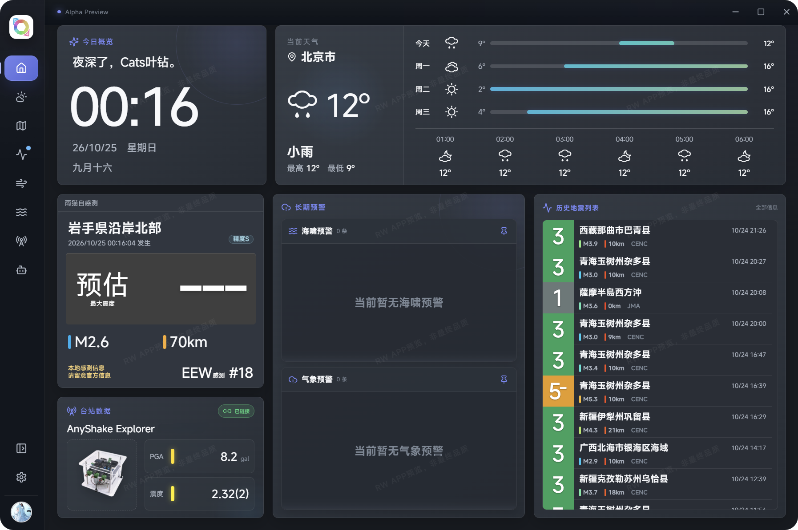
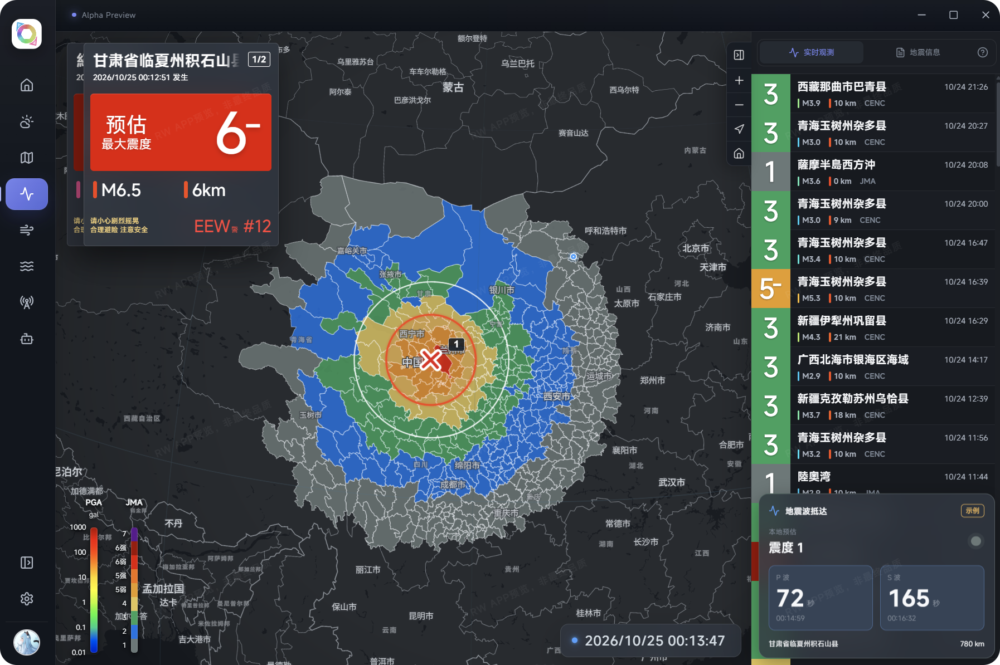
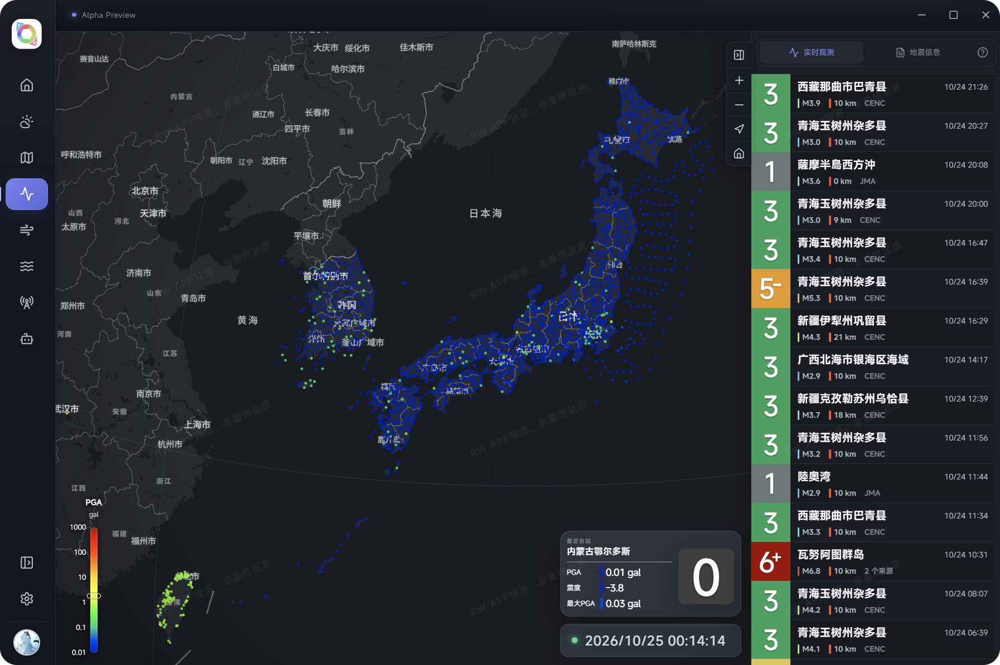
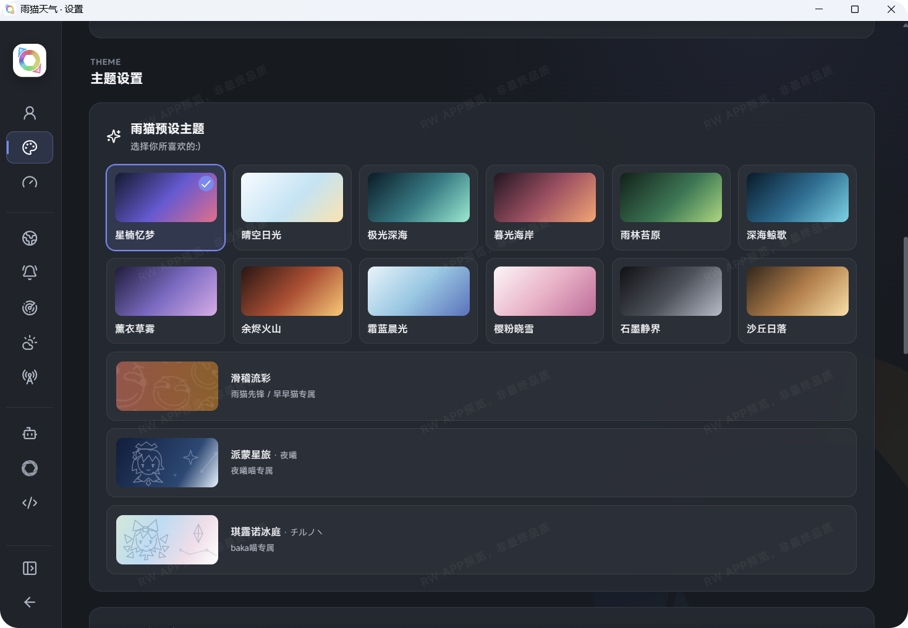
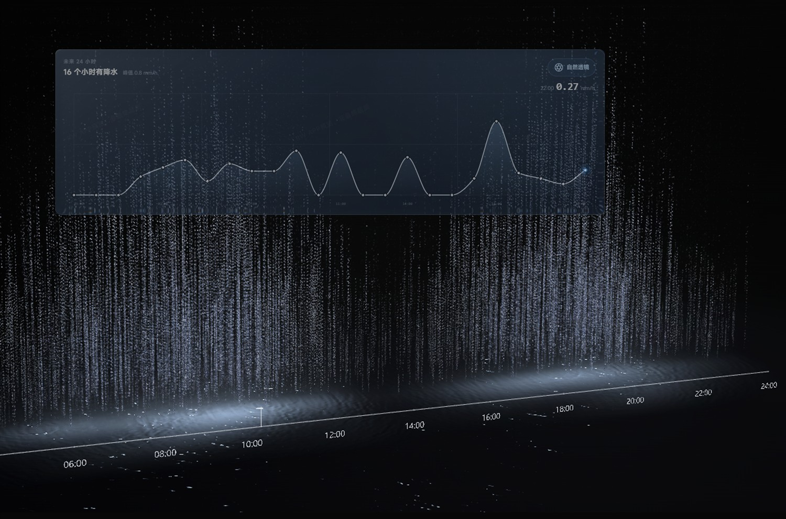

<b>简体中文</b> &nbsp; · &nbsp; <a href="README.en.md">English</a> &nbsp; · &nbsp; <a href="README.ja.md">日本語</a>

<h2 align="center">展新篇，焕新颜。</h2>

以全新视角，感知天气。

<a href="https://weather.raineko.net/"><b>访问官网</b></a> &nbsp; · &nbsp; <a href="https://weather.raineko.net/downloads.html"><b>下载体验</b></a> &nbsp; · &nbsp; <a href="https://weather.raineko.net/preview.html">参与预览计划</a> &nbsp; · &nbsp; <a href="https://weather.raineko.net/feedback.html">反馈与建议</a>

Windows &nbsp; / &nbsp; macOS &nbsp; / &nbsp; Linux &nbsp; · &nbsp; Alpha 预览版

 

<h2>概览，一目了然。</h2>

此刻的天气，关心的动态。 把纷繁信息，整理成一眼可见的日常。

你的日常，一屏尽览

<table>
  <tr>
    <td width="33%" valign="top"><h3>☁️ 天气与预报</h3>
此刻的天气，关心的动态。
</td>
    <td width="33%" valign="top"><h3>🌏 广域信息</h3>
从头顶的云，到脚下的大地，再到远方的海。
</td>
    <td width="33%" valign="top"><h3>🎨 个性化主题</h3>
从配色到氛围，让雨猫成为你的雨猫。
</td>
  </tr>
</table>

<h2>广域信息，天下我有。</h2>

连接广域数据，持续接收动态。 从信息到提醒，让每一次变化及时抵达。

地震预警与震度分布 · 界面截图

<h3>台站观测，一图尽览。</h3>

台站分布与实时观测界面

 

<table>
  <tr>
    <td width="50%" valign="top"><h3>主题随心换， 怎样都好看。</h3>
轻轻一点，换一种心情。 从配色到氛围，让雨猫成为你的雨猫。
</td>
    <td width="50%" valign="top"><h3>换上自然透镜， 聆听自然的声音。</h3>
让降水成为眼前的风景，让雨声填满片刻宁静。 天气，也可以用感受来读懂。
</td>
  </tr>
  <tr>
    <td width="50%" valign="middle"></td>
    <td width="50%" valign="middle"></td>
  </tr>
</table>

概览、主题、预警地图和台站分布使用用户提供的近期截图；自然透镜沿用官网宣传素材。图片仅展示软件界面，不代表实时天气或灾情。

<h2>从这里开始</h2>

前往 <a href="https://weather.raineko.net/downloads.html">下载页面</a>，选择适合自己设备的版本。想参与测试，可以先了解 <a href="https://weather.raineko.net/preview.html">雨猫天气预览计划</a>。

使用过程中遇到问题，或有想分享的建议，欢迎通过 <a href="https://weather.raineko.net/feedback.html">反馈页面</a> 告诉我们。

<blockquote>
雨猫天气目前处于 Alpha 预览阶段，功能与体验仍在完善。灾害信息仅供参考，请以当地官方发布为准。
</blockquote>

雨猫天气为闭源软件。本页用于产品介绍与展示，不代表开放软件源代码或授予开源许可。

雨猫天气，静候安宁。 知星观象，护君前行。 Raineko Weather · 雨猫天气

